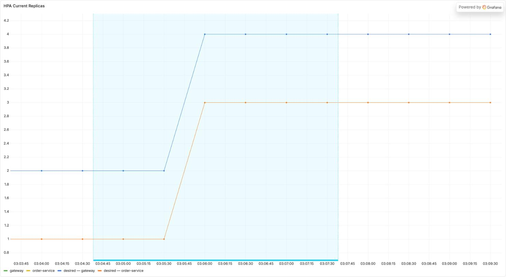
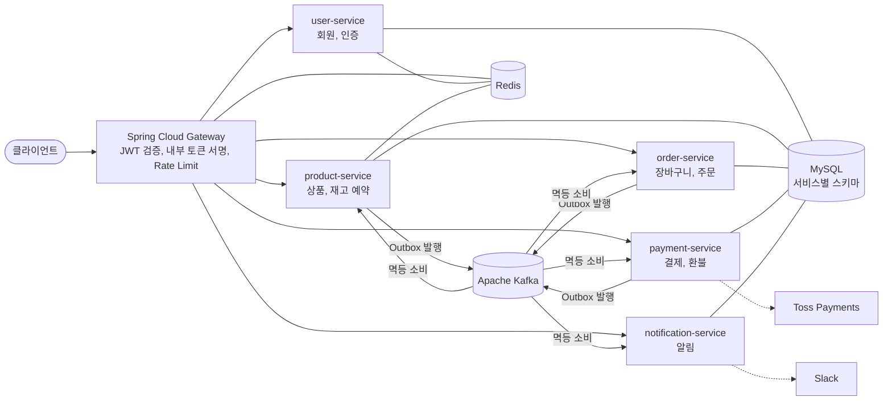
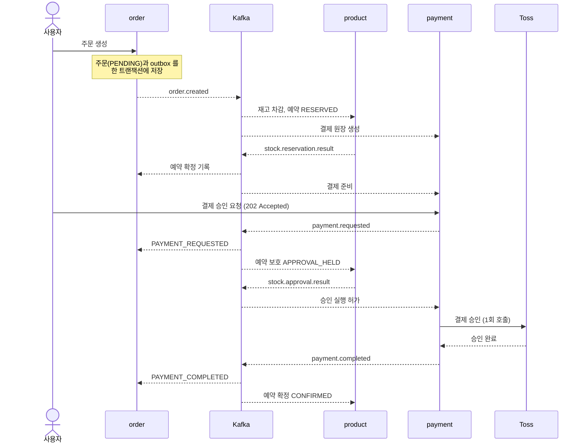
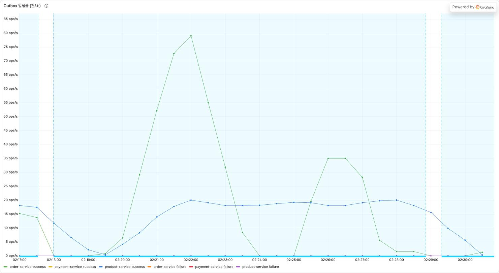

# PeekCart

> 모놀리식으로 시작해 도메인 서비스 5개로 나눈 이커머스 백엔드입니다.
> 재고 불일치, 이벤트 유실과 중복을 설계로 막고 GKE 에 배포해 부하를 걸어 확인했습니다.

[](https://github.com/Kimgyuilli/PeekCart/actions/workflows/ci.yml)


[결과 요약](#결과-요약), [아키텍처](#아키텍처), [모놀리식에서 MSA 로](#모놀리식에서-msa-로), [대표 사례](#대표-사례), [그 밖의 개선](#그-밖의-개선), [기술 스택](#기술-스택), [문서](#문서), [개발 환경](#개발-환경)

## 결과 요약

부하 수치는 GKE 에서 잰 값입니다. 측정마다 조건이 달라서 시점과 조건을 같이 적었습니다.

| 항목 | 결과 | 조건 | 자세히 |
|---|---|---|---|
| 주문 생성 처리량 | 초당 54.0건에서 158.6건으로 (2.94배), p95 2.38초에서 879ms 로 | MySQL CPU 상한 500m 에서 2000m 으로 (2026-09-17) | [A](#a-mysql-cpu-상한이-병목이었다) |
| 재고 정합성 | 상품 하나에 초당 170건씩 주문이 들어와도 음수 재고 0, 품목별 재고 불일치 0 | product 3대, 분산 락 없음 (2026-10-24, 10-26) | [B](#b-재고-경로에서-분산-락을-뺐다) |
| 이벤트 발행 | 재고 예약 결과 발행 대기 p50 154초에서 0.5초로, 결제 전 만료 취소 3,839건에서 0건으로 | 초당 170건 경합 부하 (2026-10-24, 10-26) | [C](#c-outbox-발행-설정이-처리량-상한이었다) |
| 자동 확장 | 부하 시작 42초 뒤 order-service 를 1대에서 3대로 늘리기로 결정, 93초에 3대 모두 Ready, 5xx 0 | HPA, 초당 100건 3분 (2026-10-24) | 아래 그래프 |
| 결제 연동 | Toss 테스트 API 로 승인과 환불 경로가 끝까지 성공 | Toss 공개 테스트 키 (2026-10-26) | [D](#d-이벤트-유실과-중복-실패를-다루는-메시징) |

<p align="center">
  
</p>
<p align="center"><sub>주문 부하 중 HPA 레플리카 수 (2026-10-24, GKE). order-service 는 1대에서 3대로, gateway 는 2대에서 4대로 늘었습니다.</sub></p>

## 아키텍처



결제까지 성공한 주문 하나에서 서비스끼리 주고받는 메시지는 모두 Kafka 이벤트입니다.



결제가 실패하면 `payment.failed` 를 받은 product 가 예약을 풀어 재고를 되돌리고, order 는 주문을 취소합니다.
결제는 끝났는데 주문이 이미 취소됐거나 재고 예약이 없는 경우처럼 상태가 어긋나면, 보상 요청
(`order.compensation.requested`, `stock.compensation.requested`)을 받은 payment 가 환불하고 `payment.refunded` 로
보상을 마칩니다([ADR-0018](docs/adr/0018-compensation-refund-contract.md)).

그림에서는 notification 의 구독, `product.updated`(주문 서비스의 상품 단가 캐시), 승인 대사 복구 토픽 4개, DLQ 토픽을
뺐습니다. 전체 토픽 표는 [상세 설계 §8-1](docs/04-design-deep-dive.md#8-1-이벤트-토픽-설계)에 있습니다.

## 모놀리식에서 MSA 로

| 항목 | 모놀리식 (Phase 1) | 현재 |
|---|---|---|
| 배포 단위 | Spring Boot 애플리케이션 하나 | 도메인 서비스 5개와 Spring Cloud Gateway |
| 데이터 | MySQL 하나 | MySQL 서비스별 스키마 5개 |
| 서비스 간 통신 | 같은 JVM 안의 `@TransactionalEventListener` | Kafka 와 Transactional Outbox, Choreography Saga |
| 결제 실패 처리 | 커밋 뒤 이벤트를 받아 실행하는 로컬 보상 트랜잭션 | 각 서비스가 이벤트를 받아 주문 취소와 재고 복구를 처리 |
| 실행 환경 | Docker Compose, 애플리케이션은 로컬 실행 | Kubernetes(Kustomize), 부하 측정은 GKE |

Phase 1 모놀리식 구현, Phase 2 성능 개선(Redis 캐시, Kafka 와 Outbox, 재고 동시성 제어), Phase 3 인프라와 테스트
(K8s 배포, Prometheus 와 Grafana, 부하 테스트, HPA), Phase 4 MSA 분리 순서로 진행했습니다. Phase 5 부터는 로드맵 없이
필요한 작업을 골라서 합니다. 단계별 이력은 `docs/progress/PHASE1.md`~`PHASE6.md` 에 있습니다.
서비스를 떼어낸 순서와 공유 MySQL 을 서비스별 스키마로 나눈 과정은 블로그에 썼습니다([학습 기록 20](https://blog.rlarbdlf222.workers.dev/blog/peekcart-monolith-peel-order/),
[학습 기록 21](https://blog.rlarbdlf222.workers.dev/blog/peekcart-db-per-service-schema/)).

## 대표 사례

### A. MySQL CPU 상한이 병목이었다

- **문제**: 200 사용자, 목표 300 rps, 2분 부하에서 주문 생성이 초당 54.0건에 그쳤습니다. 측정 중 MySQL CPU 는
  498m/500m 로 상한까지 쓰고 있었습니다.
- **결정**: 다른 조건은 그대로 두고 MySQL `limits.cpu` 만 바꿨습니다. 상품 상세 조회는 500m, 2000m, 다시 500m 순서로
  재서 상한을 되돌리면 처리량도 돌아오는 것을 본 뒤 base 상한을 2000m 으로 정했습니다([ADR-0027](docs/adr/0027-mysql-cpu-limit-baseline.md)).
- **결과**: 주문 생성은 초당 54.0건에서 158.6건으로 2.94배가 됐고, p95 는 2.38초에서 879ms 로 낮아졌습니다. 상품 상세(캐시 OFF)는
  393 rps 에서 904 rps 로 올랐고, MySQL 스로틀은 60초 런 기준 147.6초에서 0.1초로 줄었습니다. 500m 으로 되돌리자 392.6 rps(+0.2%)로 돌아왔습니다.
- 근거: [주문 경로 측정](docs/progress/evidence/d002bc-gke-20260917.md), [읽기 경로 측정](docs/progress/evidence/d026-d002a-read-ceiling-20260920.md)
- 블로그 글: [학습 기록 28: "병목이 아니다"라는 측정은 무엇을 배제했을까?](https://blog.rlarbdlf222.workers.dev/blog/peekcart-ruled-out-bottleneck/)

### B. 재고 경로에서 분산 락을 뺐다

- **문제**: Phase 4 경합 실험(product 3대, 같은 상품)에서 락 획득 실패(`PRD-004`)는 0건인데 낙관적 락 충돌 7건이 DLQ 로
  갔습니다. 락 획득은 늘 성공했지만 커밋에서 충돌했고, 오버셀은 `@Version` 이 막고 있었습니다. 코드를 다시 보니 락
  구간 안에는 쓰기가 없었고, 락은 재고를 바꾸는 3경로 중 1곳에만 적용돼 있었으며, Redis 장애 때는 락 획득을 성공으로 처리했습니다.
- **결정**: 재고 경로의 Redis 분산 락을 빼고 `@Version` 낙관적 락과 jitter 재시도로 통일했습니다. 고정 간격 재시도에서는
  함께 충돌한 소비자들이 같은 시각에 다시 처리를 시도해 또 충돌했기 때문입니다([ADR-0025](docs/adr/0025-inventory-concurrency-control.md)).
- **결과**: product 3대 환경에서 상품 하나에 초당 170건씩 주문이 들어와도 음수 재고 0, 품목별 재고 불일치 0 이었습니다(유효 측정 3회).
- 근거: [2026-10-24 측정](docs/progress/evidence/d078-gke-20261024.md), [2026-10-26 측정](docs/plans/done/D-108.md)
- 블로그 글: 사례 A 와 같은 글의 [재고 분산 락 절](https://blog.rlarbdlf222.workers.dev/blog/peekcart-ruled-out-bottleneck/#재고-분산-락-원인을-구별하지-못한-0건)

### C. Outbox 발행 설정이 처리량 상한이었다

- **문제**: outbox poller 기본값(5초마다 100건)의 이론 상한은 초당 20건입니다. Phase 4 에서 주기 500ms, 배치 500건으로
  완화하면 초당 77.3건(4.8배)까지 오르는 것을 확인했지만 기본값은 그대로였습니다. 2026-10-24 경합 측정에서 재고 서비스의
  발행률이 상한인 초당 20건에서 더 오르지 않았고, 예약 결과가 늦게 나가 주문 10,111건 중 3,839건이 결제 전에 만료 취소됐습니다.
- **결정**: base 기본값을 주기 500ms, 배치 500건으로 바꿨습니다([ADR-0045](docs/adr/0045-outbox-polling-throughput-defaults.md)).
- **결과**: 2026-10-26 같은 부하(초당 170건, 60초)에서 재고 예약 결과의 발행 대기 p50 이 154초에서 0.5초로 줄었고, 만료
  취소는 0건이 됐습니다(DLQ 로 간 주문 제외). 두 세션은 가상 사용자 수(200, 450)가 다릅니다.
- 근거: [2026-09-17 측정](docs/progress/evidence/d002bc-gke-20260917.md), [2026-10-24 측정](docs/progress/evidence/d078-gke-20261024.md), 지연 집계([10-24](loadtest/reports/2026-10-24/latency-summary.txt), [10-26](loadtest/reports/2026-10-26/latency-summary.txt))

<p align="center">
  
</p>
<p align="center"><sub>기본값을 바꾸기 전 경합 측정(2026-10-24, 초당 170건 주문 60초)의 Outbox 발행률. 재고 서비스 발행률(파란 선)이 초당 20건 근처에서 더 오르지 않습니다.</sub></p>

### D. 이벤트 유실과 중복, 실패를 다루는 메시징

Outbox, 멱등성 처리, DLQ 원장은 공유 모듈 `peekcart-common-messaging` 하나에 있고, order, product, payment,
notification 이 같이 씁니다([ADR-0033](docs/adr/0033-shared-messaging-module.md)).

- **유실**: 비즈니스 데이터와 이벤트를 같은 DB 트랜잭션으로 outbox 테이블에 저장하고, poller 가 Kafka 로 발행합니다.
- **중복**: 소비자는 `processed_events` 로 이미 처리한 이벤트를 걸러냅니다.
- **실패**: 재시도 뒤에도 실패한 메시지는 DLQ 토픽을 거쳐 서비스별 DLQ 원장에 남고, 알림을 받은 관리자가 원장 상태를
  바꾸거나 replay 합니다([ADR-0020](docs/adr/0020-dlq-replay-contract.md)).
- **결제**: 승인 전에 재고 예약을 보호 상태로 바꾸고([ADR-0034](docs/adr/0034-approval-reservation-fence.md)) 승인 원장과
  주문 단위 멱등키를 써서 같은 요청이 다시 와도 같은 결론이 나오게 합니다. 결과가 불분명하면 PG 조회로 맞춥니다
  ([ADR-0023](docs/adr/0023-payment-approval-reconciliation.md)). Toss 테스트 API 를 실제로 호출해 승인과 환불 경로가
  끝까지 성공하는 것을 확인했고 실제 응답 8건을 테스트 fixture 로 고정했습니다(`TossSandboxResponseTest` 13건).
- 근거: [Toss 실호출 기록](docs/progress/evidence/d064-toss-sandbox-20261026.md), [ADR-0012](docs/adr/0012-phase4-db-event-saga-contract.md), [ADR-0018](docs/adr/0018-compensation-refund-contract.md)
- 블로그 글: [학습 기록 11: 같은 이벤트가 두 번 왔다(Consumer 멱등성과 DLQ)](https://blog.rlarbdlf222.workers.dev/blog/peekcart-consumer-idempotency-dlq/),
  [학습 기록 26: DLQ 메시지를 원래 토픽에 다시 넣기 전에 무엇을 정해야 할까](https://blog.rlarbdlf222.workers.dev/blog/peekcart-dlq-replay-four-questions/),
  [학습 기록 24: 롤백되지 않는 환불 호출에서 '한 번'은 어디서 셀까](https://blog.rlarbdlf222.workers.dev/blog/peekcart-saga-refund-exactly-once/)

## 그 밖의 개선

| 항목 | 결과 | 조건 | 근거 |
|---|---|---|---|
| CI 시간 | 36분에서 11~15분으로 | PR 전체 실행 기준 (2026-09-22, 2026-10-24~27) | 워크플로 재배치와 통합 테스트 컨테이너 공유([ADR-0028](docs/adr/0028-integration-test-container-lifecycle.md)), e2e 3러너 분할([ADR-0044](docs/adr/0044-ci-critical-path-and-docs-only-skip.md)), [블로그 글](https://blog.rlarbdlf222.workers.dev/blog/peekcart-ci-critical-path/) |
| 조회 캐시 | TPS 265.0에서 612.7로 (2.31배) | 모놀리식, nGrinder 50 VU (2026-04-09) | [측정 리포트](loadtest/reports/2026-04-09/REPORT.md), [블로그 글](https://blog.rlarbdlf222.workers.dev/blog/peekcart-cache-effect-measurement/) |
| 커서 페이지네이션 | 깊이 900 에서 검사 행 20 대 920 (46배) | Testcontainers MySQL 8.0.46 (2026-08-30) | [실행 계획 기록](docs/progress/evidence/impl6-cursor-queryplan-20260830.md), [블로그 글](https://blog.rlarbdlf222.workers.dev/blog/peekcart-unsorted-pagination-cursor/) |

## 기술 스택

| 분류 | 기술 |
|---|---|
| 언어와 프레임워크 | Java 17, Spring Boot 3.5, Spring Cloud Gateway(Spring Cloud 2025.0), Spring Data JPA |
| 데이터 | MySQL 8.0 (서비스별 스키마), Flyway, Redis 7.2 |
| 메시징 | Apache Kafka 3.8, Transactional Outbox, ShedLock |
| 외부 연동 | Toss Payments, Slack Webhook |
| 인프라 | Docker, Kubernetes(Kustomize), GKE, minikube |
| 모니터링 | Prometheus, Grafana |
| 테스트와 측정 | JUnit 5, Mockito, Testcontainers, k6, GitHub Actions |
| 구조 | Gradle 멀티모듈 모노레포, 4-Layered + DDD |

## 문서

문서 전체의 위치와 역할은 [문서 맵](docs/README.md)에 있습니다.

| 설계 문서 (현재 상태) | 내용 |
|---|---|
| [프로젝트 개요와 기술 스택](docs/01-project-overview.md) | 목표, 기술 선택과 대안 비교, 운영 환경 |
| [아키텍처](docs/02-architecture.md) | 4-Layered + DDD, 시스템 다이어그램, 모듈과 배포 구조 |
| [요구사항](docs/03-requirements.md) | 기능과 비기능 요구사항, 핵심 API |
| [상세 설계와 결정](docs/04-design-deep-dive.md) | Kafka 이벤트 설계, 재고 동시성과 Saga 같은 주요 결정, 한계와 트레이드오프 |
| [데이터 설계](docs/05-data-design.md) | 서비스별 ERD, 공통 메시징 테이블, 인덱스 전략 |
| [테스트 전략](docs/06-testing-strategy.md) | 레이어별 테스트, E2E 계약 게이트, 성능 테스트 시나리오 |

| 찾는 것 | 위치 |
|---|---|
| 결정 근거 | [ADR 색인](docs/adr/README.md) |
| 열린 작업과 부채 | [docs/TASKS.md](docs/TASKS.md) |
| 단계별 작업 이력 | `docs/progress/PHASE1.md`~`PHASE6.md` |
| 운영 절차 | `docs/runbooks/` |
| 부하 측정 절차 | [loadtest/README.md](loadtest/README.md) |

## 개발 환경

클론한 뒤 한 번 설정합니다.

```bash
git config core.hooksPath .githooks
```

`pre-commit` 과 `commit-msg` 훅이 커밋할 때 규약을 강제합니다. 설정하지 않으면 훅이 실행되지 않고 경고도 나오지 않습니다.

| 훅 | 검사 | 탈출구 |
|---|---|---|
| `pre-commit` | "한 커밋 = 한 분류" (`/ship` §3) | `HPX_ALLOW_MIXED=1 git commit ...` |
| `commit-msg` | 메시지 문체 (`docs/conventions/writing.md`) | `HPX_ALLOW_STYLE=1 git commit ...` |

분류 검사와 문체 검사를 따로 끌 수 있게 탈출구 변수를 나눴습니다. 변수가 하나면 혼합 커밋을 의도할 때 문체 검사까지
함께 꺼집니다.
