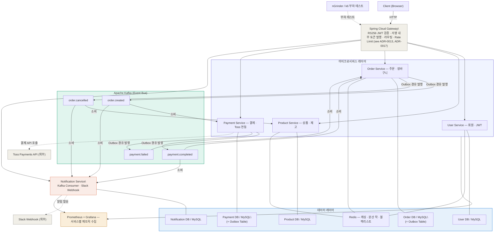

## 4. 아키텍처 방향

### 4-1. 코드 아키텍처: 4-Layered + DDD

각 도메인은 아래 4개 레이어로 구성됩니다.

| 레이어 | 패키지 | 역할 |
| --- | --- | --- |
| Presentation | `presentation/` | Controller, Request/Response DTO |
| Application | `application/` | UseCase, Command/Query 조율, 트랜잭션 경계 |
| Domain | `domain/` | Entity, VO, Domain Service, Repository 인터페이스 |
| Infrastructure | `infrastructure/` | Repository 구현체, Kafka, Redis, Toss 연동 |

> **핵심 원칙**: 비즈니스 로직은 Service가 아닌 Entity / Domain Service 안에 위치합니다.
**JPA 절충안**: 도메인 엔티티에 JPA 어노테이션(`@Entity`, `@Id`, `@Column` 등)을 허용하되, 비즈니스 로직은 JPA API(`EntityManager`, `Session` 등)에 의존하지 않습니다. Entity-Domain Entity 분리 + 매핑 레이어의 보일러플레이트를 피하면서도 도메인 순수성을 유지하는 실용적 절충안이며, 실무에서도 일반적인 접근 방식입니다.
>

### 4-2. 서비스 전략: 모놀리식 → MSA 분리

| 단계 | 구조 | 내용 |
| --- | --- | --- |
| Phase 1 | 모놀리식 | 단일 Spring Boot, 4-Layered + DDD, `@TransactionalEventListener` |
| Phase 2 | 성능 개선 | Redis 캐싱, Kafka + Outbox 패턴 도입, 재고 동시성 제어 |
| Phase 3 | 인프라 / 테스트 | K8s 배포, Prometheus + Grafana, 부하 테스트, HPA 검증 |
| Phase 4 | MSA 분리 | Gradle 멀티모듈, Spring Cloud Gateway, 서비스별 DB 분리 |

### 4-3. 인프라 전략: Kubernetes + Kustomize

- **Phase 1~2**: Docker Compose 로 MySQL/Redis/Kafka 만 컨테이너화, 앱은 로컬 실행
- **Phase 3 (Task 3-1 ~ 3-3)**: 로컬 minikube K8s 로 매니페스트/관측성 스택 초기 구축
- **Phase 3 (Task 3-4 ~ ) · Phase 4**: GCP / GKE 로 전환. 부하 테스트/HPA/MSA 운영
- **매니페스트 구조**: Kustomize `base/` + `overlays/{minikube, gke}/` (ADR-0005)
- **관측성 스택**: kube-prometheus-stack Helm 차트. base/ 와 분리된 `k8s/monitoring/` 트리에서 환경별로 관리 (ADR-0006). install.sh 로 멱등 설치
- HPA 로 Order Service Pod 자동 수평 확장 검증
- Liveness / Readiness / Startup Probe 설정으로 비정상 Pod 자동 재시작

> 환경 진화와 선택 근거의 상세: `docs/01-project-overview.md` §4 (SSOT), ADR-0004 (§Context 가 Phase 3 초기 minikube 근거 포함), ADR-0005, ADR-0006 (monitoring 스택 환경 분리).

### 4-4. 레포 전략: 모노레포 (Gradle 멀티모듈) (Phase 4 모듈 구조는 see ADR-0011, ADR-0014)

- 단일 GitHub 레포에서 전체 서비스 구조를 한눈에 파악 가능
- `common` 모듈로 이벤트 DTO, 공통 예외, 응답 포맷 공유 + `peekcart-common-observability` 모듈(ADR-0009 선결정) + `peekcart-common-auth` 모듈(내부 토큰 검증 — 사용자 JWT 검증은 ADR-0014 D2-c 로 종료, ADR-0017) + `peekcart-common-messaging` 모듈(outbox·멱등성·DLQ 원장 실행 세트, ADR-0033) + `internal-token-contract` 모듈(내부 토큰 이름 계약, 프레임워크 의존 0 — 발행 `gateway`/검증 `peekcart-common-auth` 가 서로 의존 불가) + 5개 서비스 모듈 (경계·의존 규칙은 ADR-0011/ADR-0014/ADR-0033)
- 실무 기준에서는 서비스별 독립 배포와 권한 분리를 위해 멀티레포가 적합하나, 포트폴리오 가시성과 개발 효율을 위해 모노레포 채택

### 4-5. MSA 분리 대상 서비스 (see ADR-0010)

Phase 4 는 5개 도메인을 모두 독립 서비스로 분해한다 (경계·이벤트 토폴로지·Saga 골격의 SSOT 는 ADR-0010). 각 서비스의 분리 동기:

- **User Service** — 회원·JWT 인증/인가 (Gateway 인증 경로의 기반)
- **Product Service** — 상품·카테고리·**재고 소유자**, CQRS 로컬 캐시용 Product→Order 캐시 이벤트의 발행처 (이벤트 명칭·스키마는 A3 확정)
- **Order Service** — 주문 폭주 시 독립 스케일아웃 필요
- **Payment Service** — 결제 플로우 격리, 장애 전파 방지
- **Notification Service** — Kafka Consumer + Slack 발송, 알림 영속(Notification DB 소유)

---

## 5. 시스템 아키텍처 다이어그램

> Phase 1 모놀리식 다이어그램은 `docs/progress/design-archive-phase1-2.md` 로 옮겼다.

### Phase 4 — MSA

> 현재 이벤트 토폴로지는 **11개 토픽**이다. ADR-0012의 7개 토픽과 ADR-0018의 보상/환불 3개에 `stock.approval.result`가 추가됐다(see ADR-0034). `payment.requested`는 Order와 Product가 소비하고, Product의 보호 회신은 Payment가 소비한다. 서비스 직접 호출 없이 재고 보호 확인 뒤 PG를 호출한다. **토픽 생성은 producer-owns-topic**: Order는 `order.*`, Payment는 `payment.*`, Product는 `product.updated`/`stock.*` 및 각 `.dlq`를 소유한다. 계약의 현재 코드 정본은 `DlqTopology`이며 아래 다이어그램은 ADR-0010 시점의 4토픽 골격이다.



---

## 12. 패키지 구조

> 현재 Gradle 멀티모듈 구조와 배포 파일은 아래 트리를 따른다. 모듈 경계·의존 규칙은 ADR-0011/0014/0033, Phase 1·2 패키지 구조는 [설계 아카이브](progress/design-archive-phase1-2.md#02-architecturemd-12-패키지-구조)를 참조한다. 루트는 빌드/가드 aggregator이며 애플리케이션 `src/`는 각 모듈에 있다.

### 레이어 책임 원칙

| 레이어 | 의존 방향 | 핵심 원칙 |
| --- | --- | --- |
| Presentation | → Application | DTO 변환만 담당, 비즈니스 로직 없음 |
| Application | → Domain | 트랜잭션 경계, UseCase 조율 |
| Domain | 없음 | JPA 어노테이션 허용, JPA API 미의존, 순수 비즈니스 로직 |
| Infrastructure | → Domain | Repository 인터페이스 구현, 외부 연동 |

### 현재 인프라 매니페스트 (Kustomize base/overlays)

Phase 3에서 도입한 base/overlay 분리는 현재 5개 도메인 서비스와 gateway의 배포에 쓰인다(see ADR-0005, ADR-0006). 아래는 주요 경로이며 전체 리소스 목록은 [base kustomization](../k8s/base/kustomization.yml)이 정본이다. 과거 루트 `src/`와 `services/peekcart/`를 포함한 Phase 3 트리는 [D-101 정정 전 기록](https://github.com/Kimgyuilli/PeekCart/blob/be535c57ced11acfcbe9a24a349ddb6ad2055d8a/docs/02-architecture.md#phase-3--인프라-매니페스트-kustomize-baseoverlays)에서 확인할 수 있다.

```text
k8s/
├── base/
│   ├── namespace/namespace.yml
│   ├── infra/
│   │   ├── mysql/{mysql.yml,secret.yml,init-configmap.yml}
│   │   ├── redis/redis.yml
│   │   └── kafka/kafka.yml
│   ├── services/
│   │   ├── gateway/                  # deployment.yml에 API·metrics Service 포함
│   │   │   ├── deployment.yml
│   │   │   ├── configmap.yml
│   │   │   ├── serviceaccount.yml
│   │   │   ├── secretproviderclass.yml
│   │   │   └── servicemonitor.yml
│   │   ├── order-service/            # 각 deployment.yml에 Deployment + Service
│   │   ├── payment-service/          # 각 도메인 서비스에 configmap·secret·servicemonitor
│   │   ├── product-service/
│   │   ├── notification-service/
│   │   ├── user-service/             # 서명키용 serviceaccount·secretproviderclass도 소유
│   │   ├── internal-token-keys/configmap.yml
│   │   └── user-jwt-public-keys/configmap.yml
│   ├── networkpolicy.yml
│   └── kustomization.yml
├── overlays/
│   ├── minikube/{kustomization.yml,patches/}
│   └── gke/
│       ├── kustomization.yml
│       ├── README.md
│       ├── hpa.yml                   # order-service 및 gateway HPA
│       └── patches/
└── monitoring/                       # base와 분리된 관측성 스택 (ADR-0006)
    ├── namespace.yml
    ├── shared/{kustomization.yml,grafana-alerts.yml,*.json}
    ├── minikube/{values-prometheus.yml,install.sh}
    └── gke/{values-prometheus.yml,install.sh}
```

측정·키 회전 리허설용 추가 overlay는 `k8s/overlays/`에 별도로 있다. 일반 배포 진입점은 위 `minikube`/`gke`이며 배포 순서는 다음과 같다.

- **최초 배포 순서 (fresh 클러스터, minikube 기준)**:
  1. `kubectl apply -f k8s/monitoring/namespace.yml` — monitoring NS 단일 생성 주체 (ADR-0006 불변식 5)
  2. `bash k8s/monitoring/minikube/install.sh` — kube-prometheus-stack Helm 설치. **이 단계가 ServiceMonitor CRD 를 등록**하므로 다음 단계 전에 반드시 선행
  3. `kubectl apply -k k8s/monitoring/shared/` — 환경 무관 대시보드/Alert ConfigMap (kustomize 가 *.json → ConfigMap 생성, Grafana sidecar 자동 로드)
  4. `bash scripts/deploy-overlay.sh k8s/overlays/minikube` — app/infra + ServiceMonitor 적용. 2번이 등록한 CRD 가 충족되어야 성공.
     **앱 overlay 배포는 래퍼를 쓴다** (see ADR-0022 §D3) — replay 행이 남은 상태로 구 이미지를 배포하면 발행 경로가 손상되므로, 래퍼가 `scripts/replay-drain-preflight.sh` 를 선행시킨다. 빈 namespace 의 첫 배포는 preflight 가 조회할 스택이 없어 fail-closed 로 막으므로, `DRAIN_PREFLIGHT_SKIP_REASON` 에 사유를 남겨 건너뛴다(`k8s/overlays/gke/README.md` 4' 단계). 1~3 단계(monitoring/shared)는 서비스 이미지를 바꾸지 않아 raw `apply -k` 를 그대로 쓴다. 래퍼는 우회 가능하며 그 한계는 ADR-0022 가 명시한다
     **래퍼는 앱보다 kafka 를 먼저 올린다** (D-107). 브로커 자동 생성 설정은 그대로 두고, 빈 브로커에서 컨슈머가 토픽을 1파티션·기본 config 로 먼저 만드는 경로를 없앤다. overlay 렌더에서 Namespace 와 kafka PVC·Deployment·Service 만 적용해 롤아웃을 기다린 뒤, E2E 와 같은 정본(`kafka-subscription-contract-lint.sh --emit-topics`, 토픽 30개)의 선언 파티션 수로 `--create --if-not-exists` 하고 describe 로 대조해 다르면 앱을 적용하지 않는다. 이미 떠 있는 스택에서는 생성이 건너뛰어지고 대조만 남는다. 토픽 config 7키는 소유 서비스 KafkaAdmin 이 기동 중과 기동 뒤 재적용에서 맞추고, 측정 run 직전 상태는 `scripts/kafka-topic-state-guard.py` 가 다시 확인한다. 래퍼에 넘긴 overlay 전부(운영 `gke`·`minikube`, `loadtest/README.md` 의 측정 overlay)에 적용되며, kafka 가 없는 overlay 는 `TOPIC_PRECREATE_SKIP_REASON` 에 사유를 남겨 건너뛴다. raw `kubectl apply -k` 에는 이 단계가 없다
- **"self-contained overlay" 의 운영 해석 (ADR-0006 불변식 4)**: `apply -k overlays/minikube/` 가 단독으로 fresh 클러스터에 성공한다는 뜻이 **아니다**. ServiceMonitor 는 CRD 의존성을 가지며, K8s 생태계의 표준 패턴(cert-manager, Istio 등)과 동일하게 CRD 선행 설치가 문서화된 순서로 보장된다. overlay 가 self-contained 라는 것은 "monitoring NS 리소스를 포함하지 않으며, 외부 상태를 만들거나 변형하지 않는다" 는 의미이다.
- **재배포 (idempotent)**: 동일 4개 명령을 순서대로 재실행. install.sh 는 `helm upgrade --install` 멱등
- **최초 배포 순서 (fresh 클러스터, GKE)**: minikube 와 동일한 4단계. install 진입점만 환경별로 분리:
  1. `kubectl apply -f k8s/monitoring/namespace.yml`
  2. `bash k8s/monitoring/gke/install.sh` — Internal LB Grafana, retention 24h, PVC standard-rwo
  3. `kubectl apply -k k8s/monitoring/shared/`
  4. `bash scripts/deploy-overlay.sh k8s/overlays/gke` — apply 전 `kustomize edit set image` 로 PROJECT_ID 치환 (`k8s/overlays/gke/README.md` 참고). 편집 결과는 커밋하지 않음
- **GKE 운영 체크리스트** (ADR-0004): 측정 종료 시 클러스터/VM/PD/예약 IP 정리. 상세 명령은 `k8s/overlays/gke/README.md` 또는 ADR-0004 §운영 체크리스트
- **서비스 추가 시**: `k8s/base/services/` 하위에 형제 디렉토리 추가 + 각 서비스의 `servicemonitor.yml` 동봉 + `base/kustomization.yml` 에 참조 추가 (ADR-0006 §긍정적 영향)

### Phase 4 — MSA (Gradle 멀티모듈)

[settings.gradle](../settings.gradle)이 포함하는 11개 모듈의 현재 위치다. 공유 라이브러리 5개와 도메인 서비스 5개, gateway로 구성되며 root는 배포 앱이 아니다(see ADR-0011, ADR-0014, ADR-0033).

```text
peekcart/
├── build.gradle                      # 공통 빌드 설정·의존 가드
├── settings.gradle
├── docker-compose.yml
├── k8s/                              # 위 현재 인프라 트리 참조
├── common/
│   └── src/main/java/com/peekcart/global/
│       ├── outbox/dto/                # 이벤트 payload·KafkaEventEnvelope
│       ├── kafka/                     # 토폴로지·헤더·MDC·backoff
│       ├── port/                      # SlackPort
│       ├── slack/
│       ├── cache/ · config/ · entity/ · exception/ · filter/ · lock/
│       ├── deadletter/ · replay/ · retention/   # 설정·공통 타입
│       └── response/
├── internal-token-contract/
│   └── src/main/java/com/peekcart/internaltoken/InternalTokenContract.java
├── peekcart-common-observability/
│   └── src/main/java/com/peekcart/global/
│       ├── config/                    # MetricsConfig·ActuatorSecurityConfig
│       └── metrics/                   # CommitAwareMetrics
├── peekcart-common-auth/
│   └── src/main/java/com/peekcart/global/
│       ├── auth/                      # LoginUser·인자 해석
│       ├── config/
│       ├── jwt/                       # 공개키·PEM 설정
│       └── security/                  # 내부 토큰 검증·서비스 보안 구성
├── peekcart-common-messaging/
│   └── src/main/java/com/peekcart/global/
│       ├── outbox/                    # 원장·polling 발행
│       ├── idempotency/               # processed_events
│       ├── deadletter/                # DLQ 원장·replay 실행
│       └── config/ShedLockConfig.java
├── gateway/
│   └── src/main/java/com/peekcart/gateway/
│       ├── auth/                      # 사용자 JWT 검증·내부 토큰 발행
│       ├── ratelimit/
│       ├── observability/
│       └── config/
├── user-service/
├── product-service/
├── order-service/
├── payment-service/
└── notification-service/
```

각 도메인 서비스는 `<service>/src/main/java/com/peekcart/<domain>/` 아래에 `presentation/`, `application/`, `domain/`, `infrastructure/`를 둔다. 독립 부팅 진입점은 각 모듈에 있고, DLQ를 소비하는 서비스의 `global/deadletter/`도 해당 서비스 모듈에 있다. 각 서비스의 `src/main/resources/db/migration/`에 독립 Flyway 이력이 있다. Outbox·멱등성·DLQ 원장 실행 세트는 `peekcart-common-messaging`을 order/payment/product/notification이 공유하고, 테이블 스키마와 서비스별 DLQ 구독·소유자 선언은 서비스가 소유한다(see ADR-0033).
