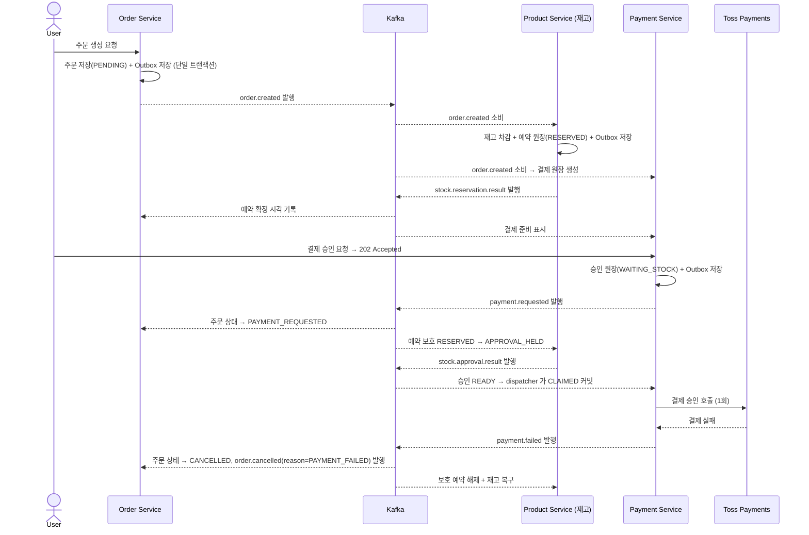

## 8. Kafka 이벤트 설계

### 8-1. 이벤트 토픽 설계

| 토픽명 | Producer | Consumer | 설명 |
| --- | --- | --- | --- |
| `order.created` | Order Service | Payment Service, Product Service, Notification Service | 주문 생성 → 재고 예약 |
| `payment.requested` | Payment Service | Order Service, Product Service | 비동기 승인 접수 및 재고 보호 요청 (ADR-0034) |
| `stock.approval.result` | Product Service | Payment Service | 영속 재고 보호 결과, payload=`{orderId, granted}`, key=orderId (ADR-0034) |
| `payment.completed` | Payment Service | Order Service, Product Service, Notification Service | 결제 성공 → 예약 확정 |
| `payment.failed` | Payment Service | Order Service, Product Service, Notification Service | 결제 실패 → Saga 보상 트랜잭션 + 알림 |
| `order.cancelled` | Order Service | Payment Service, Product Service, Notification Service | 주문 취소 → 재고 복구 |
| `stock.reservation.result` | Product Service | Order Service, Payment Service | 재고 예약 결과 (reserve→pay 게이트) |
| `product.updated` | Product Service | Order Service | 상품 변경 (CQRS 단가 캐시) |
| `stock.compensation.requested` | Product Service | Payment Service | `PAID_BUT_UNRESERVED` 환불 요청 (see ADR-0018 D1) |
| `order.compensation.requested` | Order Service | Payment Service | `PAID_BUT_CANCELLED` 환불 요청 (see ADR-0018 D1) |
| `payment.refunded` | Payment Service | Order Service, Product Service, Notification Service | 환불 결과 회신 → 각 보상 원장 종결 (see ADR-0018 D4) |
| `payment.approval-recovery.requested` | Payment Service | Product Service | 보호 승인 대사 복구 요청 → 예약 snapshot 회신 (see ADR-0040) |
| `stock.approval-recovery.snapshot` | Product Service | Payment Service | 복구 대상 예약의 status·version·fence snapshot (see ADR-0040) |
| `payment.approval-recovery.execute` | Payment Service | Product Service | 승인된 복구의 예약 해제 실행 요청, snapshot version 으로 fence (see ADR-0040) |
| `stock.approval-recovery.result` | Product Service | Payment Service | 해제 결과 회신. 해제를 확인해야 복구가 `COMPLETED` 가 된다 (see ADR-0040) |

> 토픽 매트릭스의 SSOT 는 **ADR-0012 D4**(기존 7토픽) + **ADR-0018 D1**(환불 3토픽) + **ADR-0034**(승인 보호 회신/구독) + **ADR-0040**(승인 대사 복구 4토픽)이고, 구독의 코드 정본은 `DlqTopology` 입니다.
> 각 토픽은 **1 topic = 1 producer** 규약을 따르며, `NewTopic` 프로비저닝은 producer 서비스가 소유합니다.

> 모든 이벤트는 **Outbox 패턴**을 통해 발행됩니다.
Producer는 DB 트랜잭션 내에서 Outbox 테이블에 이벤트를 저장하고, 별도 Polling 스케줄러가 Kafka로 발행합니다.
>

### 8-2. 이벤트 페이로드 스키마

### order.created

```json
{
  "eventId": "550e8400-e29b-41d4-a716-446655440000",
  "eventType": "order.created",
  "timestamp": "2026-03-20T10:30:00",
  "schemaVersion": 1,
  "payload": {
    "orderId": 1001,
    "orderNumber": "ORD-20260320-0001",
    "userId": 42,
    "totalAmount": 59000,
    "items": [
      {
        "productId": 10,
        "quantity": 2,
        "unitPrice": 29500
      }
    ],
    "receiverName": "홍길동",
    "address": "서울시 강남구 ..."
  }
}
```

### payment.completed

```json
{
  "eventId": "661f9511-f30c-52e5-b827-557766551111",
  "eventType": "payment.completed",
  "timestamp": "2026-03-20T10:31:00",
  "schemaVersion": 1,
  "payload": {
    "paymentId": 501,
    "orderId": 1001,
    "userId": 42,
    "paymentKey": "toss_pay_key_abc123",
    "amount": 59000,
    "method": "CARD",
    "approvedAt": "2026-03-20T10:31:00"
  }
}
```

> envelope 은 `KafkaEventEnvelope` 이다. `timestamp` 는 시간대 없는 `LocalDateTime` 이고, `schemaVersion` 이 빠진 옛 메시지는 1 로 읽는다 (see ADR-0012).

### 8-3. DLQ(Dead Letter Queue) 전략

```
Consumer 재시도 흐름:
  1. 메시지 처리 실패 시 최대 3회 재시도 (기준 1s, 5s, 30s에 ±50% jitter 적용, see ADR-0025)
  2. 3회 초과 실패 → {원본 토픽}.dlq 토픽으로 이동
     예: order.created 실패 → order.created.dlq
  3. DLQ 도달 → 서비스별 DLQ 원장(`dead_letter_records`) 적재 → `peekcart-dlq-backlog` alert 가 운영 신호
     (Slack 은 best-effort 보조 신호 — notification-service 외에는 no-op 이므로 판정에 쓰지 않음, see ADR-0018 D6)
  4. 수동 재처리: 원인을 해결한 뒤 DLQ 관리자 경로(03 §6-6)로 원장을 전이하고,
     replay 는 kill-switch 를 켠 ADMIN 이 원본 토픽으로 재발행한다
     (재발행의 보장 수준·발행 권한 예외·좌표 유효성·종결 축은 see ADR-0020,
      진입점 개방과 drain 절차는 see ADR-0022)

DLQ 토픽:
  - 위 8-1 표의 업무 토픽 15개 모두 <topic>.dlq(파티션 1)를 둡니다 (producer 가 NewTopic 소유).
  - 예: order.created.dlq, payment.completed.dlq, payment.failed.dlq, order.cancelled.dlq,
        stock.compensation.requested.dlq, order.compensation.requested.dlq, payment.refunded.dlq
```

### 8-4. Consumer Group 네이밍 규칙

```
규칙: {service-name}-svc-{topic 요약}-group (정본은 DlqTopology 의 구독 목록)

예시:
  - payment-svc-order-created-group     (Payment Service가 order.created 소비)
  - notification-svc-order-created-group (Notification Service가 order.created 소비)
  - order-svc-payment-completed-group   (Order Service가 payment.completed 소비)
  - product-svc-order-cancelled-group   (Product Service가 order.cancelled 소비)
  - payment-svc-stock-compensation-requested-group  (환불 요청 소비, 축약 없이 규칙 그대로)
  - order-svc-payment-refunded-group    (Order Service가 환불 회신 소비)

같은 토픽을 여러 서비스가 소비할 때, 각 서비스는 독립 Consumer Group을 운영하여
서비스별 독립적 오프셋 관리와 소비 속도 조절이 가능합니다.
```

### 8-5. Choreography Saga 플로우 (결제 실패 시)

모든 발행은 Outbox 를 거친다. 서비스 사이의 직접 호출은 없다 (see ADR-0012 §D3, ADR-0034).



`order.cancelled` 는 모든 취소의 단일 이벤트다. 결제 실패로 이미 해제한 예약에 대한 두 번째 해제는 예약 원장의 상태 전이 조건 때문에 no-op 이다.

---

## 9. 주요 설계 결정

### 9-1. 재고 동시성 제어 — DB 낙관적 락과 jitter 재시도

재고 변경은 `Inventory.@Version`과 DB 트랜잭션 원자성으로 보호합니다. 재고 경로의
Redis 분산 락과 `InventoryLockFacade`는 제거했습니다 (see ADR-0025).

- 재고 예약의 선검사·차감·예약 원장·결과 Outbox 저장은 하나의 트랜잭션입니다.
  동시 변경으로 버전이 충돌하거나 차감 도중 재고가 부족해지면 전체 트랜잭션이 롤백됩니다.
- Product Kafka 소비 중 낙관락 충돌은 jitter를 적용한 최대 3회 재시도로 처리합니다.
  재시도를 소진하면 DLQ로 보내 조사·재처리합니다. 쓰기 경합을 재고 부족으로 판정하지 않습니다.
- HTTP 경로로 전파된 낙관락 충돌은 `PRD-004`와 HTTP 409로 응답합니다.
  이는 분산 락 획득 실패를 뜻하지 않습니다.
- 예약 해제의 중복 복구는 예약 상태의 원자적 전이로 막으며, 재고 행의 동시 쓰기는
  `@Version`으로 보호합니다. Redis는 이 재고 정합성 계약에 참여하지 않습니다.

이전 분산 락은 외부 트랜잭션이 커밋하기 전에 해제되어 충돌을 직렬화하지 못했습니다.
그 구성에서도 버전 검사가 충돌한 쓰기를 롤백하므로, 락 조기 해제 자체가 오버셀링을
의미하지는 않습니다. 현재 구현에는 락 Facade로 트랜잭션을 감싸는 경계가 없습니다.

### 9-2. JWT Refresh Token — DB 저장 + Redis 블랙리스트

```
refresh_tokens 테이블 (DB):  토큰 발급 이력, 만료일 관리, 영속성 보장
Redis (블랙리스트):           로그아웃된 토큰 즉시 무효화 (TTL = 남은 만료 시간)
```

DB 단독 사용 시 매 요청마다 DB 조회가 발생하고, Redis 단독 사용 시 서버 재시작에서 데이터가 유실될 수 있습니다. 두 저장소의 역할을 분리해 각 단점을 보완합니다.

> rotation 은 **이력 모델**(`family_id`/`status`/`grace_until`)이다. **Refresh Token Reuse Detection** 은 탈취를 감지하면 family 전체를 무효화하고 Gateway 가 access token 을 차단한다 (see ADR-0013 §D4).

### 9-3. Outbox 패턴 — Kafka 이벤트 유실 방지

```
기존 방식 (문제):
  DB 저장 성공 → Kafka 발행 실패 → 이벤트 유실, 데이터 불일치

Outbox 패턴 (해결):
  DB 저장 + Outbox 테이블 저장 (단일 트랜잭션)
  → Polling 스케줄러가 Outbox를 읽어 Kafka 발행
  → 발행 성공 시 Outbox 레코드 PUBLISHED 상태 업데이트
  → 실패 시 retry_count 증가, 횟수 초과 시 FAILED 처리 (운영 신호는 아래 alert)

DLQ 연계:
  Outbox 발행 자체의 FAILED와 Consumer 처리 실패의 DLQ는 별개 메커니즘입니다.
  - Outbox FAILED: Producer 측 발행 실패 (네트워크, Kafka 브로커 장애)
  - DLQ: Consumer 측 처리 실패 (비즈니스 로직 에러, 데이터 정합성 문제)
  운영 신호는 메트릭 alert 입니다 — Outbox FAILED 는 `peekcart-outbox-failed`,
  DLQ 는 `peekcart-dlq-backlog` 로 규칙과 `signal` 라벨을 분리합니다 (대응이 반대이므로).
  앱의 Slack 직접 발송은 notification-service 에서만 실제로 나가는 보조 신호입니다.
```

### 9-4. Saga 패턴 — Choreography

Phase 1 과 Phase 4 의 구현 비교 원문은 [Layer 1 이력 아카이브](progress/archive/layer1-history-phase1-4.md)로 옮겼다(D-116). 현재 Saga 흐름은 §8-5 와 ADR-0012 §D3/§D4 다.

### 9-5. 알림 발송 채널 — Slack Webhook

Notification Service는 이벤트를 수신한 후 Slack Webhook으로 실제 알림을 발송합니다. 추가 인프라 없이 실제 동작을 증명할 수 있으며, 테스트 환경에서 알림 수신을 즉시 확인할 수 있습니다.

### 9-6. 재고 차감 시점 — Product 예약 모델

주문 생성은 재고를 직접 차감하지 않는다. Product 가 `order.created` 를 소비해 재고를 차감하고 주문 단위 예약 원장(`stock_reservations`)에 `RESERVED` 로 기록한 뒤 `stock.reservation.result` 를 발행한다 (see ADR-0012 §D3, ADR-0016).

- 예약에는 lease(30분)가 있다. Order 는 결과에 실린 만료 시각이 지나도록 결제를 시작하지 않은 주문을 취소하고, Product 의 lease sweeper 는 만료 뒤 유예 5분이 지난 `RESERVED` 를 회수한다.
- 결제 승인 접수(`payment.requested`)가 오면 Product 는 만료되지 않은 `RESERVED` 를 `APPROVAL_HELD` 로 바꾸고 보호 회신을 보낸다. 취소와 lease 회수는 `RESERVED` 만 풀고, 보호된 예약은 확정된 `payment.failed` 나 성공한 환불에서만 푼다 (see ADR-0034, 아래 "승인과 재고 회수의 경합").
- `payment.completed` 는 예약을 `CONFIRMED` 로 확정한다.

전략 A(주문 생성 시 즉시 차감)를 쓰던 Phase 1~3 서술 원문은 [Layer 1 이력 아카이브](progress/archive/layer1-history-phase1-4.md)로 옮겼다(D-116).

### 9-7. Kafka Consumer 멱등성 처리

at-least-once 보장으로 인해 동일 이벤트가 중복 소비될 수 있습니다. 중복 처리 시 재고 이중 차감, 결제 이중 처리 등 치명적인 문제가 발생할 수 있어 멱등성 처리가 필수입니다.

```
처리 전략: processed_events 테이블 — save-first + UK 선점 패턴

Consumer 수신 시:
  1. (event_id, consumer_group)을 processed_events 테이블에서 조회 (빠른 경로)
  2. 이미 존재하면 → 중복 메시지로 판단, 처리 건너뜀
  3. 존재하지 않으면 → processed_events에 처리 이력 선점 기록 (INSERT)
     - UK 충돌(DataIntegrityViolationException) 발생 시 → 동시 중복으로 판단, 처리 건너뜀
  4. 비즈니스 로직 실행 (호출자 @Transactional 컨텍스트에 참여)
     - 실패 시 트랜잭션 롤백 → 처리 이력도 함께 삭제되어 재처리 가능
```

`event_id`는 Outbox 이벤트 생성 시 UUID로 부여합니다.

> 처리 이력은 9일 보존한 뒤 매일 배치(`ProcessedEventCleanupScheduler`)로 지운다. 보존 기간이 DLQ replay 안전 여유보다 짧으면 부팅이 실패한다 (see ADR-0012 §D5, ADR-0020 §D4-3).

### 9-8. 주문 상태 전이도

`orders.status`의 전이 규칙은 `OrderStatus` 가 가진다. 현재 코드가 실제로 들어가는 상태는 `PENDING`, `PAYMENT_REQUESTED`, `PAYMENT_COMPLETED`, `CANCELLED` 넷이다.

```
PENDING → PAYMENT_REQUESTED → PAYMENT_COMPLETED
   ↓              ↓
CANCELLED ←───────┘
```

| 상태 | 설명 | 들어오는 경로 |
| --- | --- | --- |
| `PENDING` | 주문 생성. 재고 예약 결과를 기다리거나 예약 확정 뒤 결제를 기다린다 | 주문 생성 |
| `PAYMENT_REQUESTED` | 결제 승인 접수 | `payment.requested` 소비. 예약 확정 전에 오면 확정할 때 전이한다 |
| `PAYMENT_COMPLETED` | 결제 승인 완료 | `payment.completed` 소비 |
| `CANCELLED` | 취소 | `PENDING` 에서 예약 실패·예약 미확정 5분·예약 lease 만료·사용자 취소, `PAYMENT_REQUESTED` 에서 결제 실패·결제 요청 뒤 15분·사용자 취소 |
| `PAYMENT_FAILED`·`PREPARING`·`SHIPPED`·`DELIVERED` | 전이 규칙만 있다 | 없음. 결제 실패는 바로 `CANCELLED` 로 가고 배송 단계는 구현하지 않았다 |

이미 취소된 주문에 `payment.completed` 가 오면 상태를 되돌리지 않고 보상 원장을 남겨 환불로 수렴한다 (see ADR-0018).

### 9-9. Kafka 파티션 키 전략

동일 주문에 대한 이벤트(`order.created` → `payment.completed` → `order.cancelled`)가 순서대로 처리되려면 파티션 키를 `order_id`로 설정해야 합니다.

```
파티션 키: order_id
  → 동일 order_id의 이벤트는 항상 같은 파티션으로 라우팅
  → 파티션 내 순서 보장
  (product.updated 의 키는 productId — see ADR-0012 §D2)

파티션 설정:
  업무 토픽 15개: 파티션 3, DLQ 토픽: 파티션 1
  Replication Factor: 1 (단일 브로커)
  정본: kafka-subscription-contract-lint.sh --emit-topics (토픽 30개)
  Consumer Group: 서비스별 독립 Consumer Group 운영 (네이밍 규칙: 섹션 8-4)
```

토픽은 producer 서비스의 KafkaAdmin 이 만들고, 배포 래퍼가 앱보다 먼저 선언 파티션 수로 만든다(`docs/02-architecture.md` §12). 서로 다른 토픽 사이에는 같은 키여도 소비 순서가 보장되지 않는다.

### 9-10. ShedLock — 스케줄러 중복 실행 방지

Pod 가 여럿이면(HPA 포함) 같은 스케줄러가 여러 Pod 에서 동시에 실행될 수 있습니다. ShedLock 으로 스케줄러가 한 인스턴스에서만 실행되도록 보장합니다. 주기와 락 보존은 서비스 base yml 이 소유하고, 주문 취소 잡은 기본값 없이 값이 빠지면 부팅이 실패합니다.

```java
// 결제 요청 뒤 15분 지난 주문 취소 — order base yml: 주기 60s, 락 최대 10m / 최소 30s
@Scheduled(fixedDelayString = "${app.scheduler.order.cancel-expired-delay}")
@SchedulerLock(name = "orderTimeoutCancelJob",
        lockAtMostFor = "${app.scheduler.order.lock-at-most-for}",
        lockAtLeastFor = "${app.scheduler.order.lock-at-least-for}")
public void cancelExpiredOrders() { ... }

// Outbox 폴링 → Kafka 발행 — 주기·최소 보존은 서비스 base yml 소유, 락 최대 5분 (see ADR-0045)
//   order·product·payment 500ms·400ms, notification 5s·4s. 최소 보존 < 주기를 부팅 시 검사한다
@SchedulerLock(name = "${app.outbox.lock-name:outboxPollingJob}", lockAtMostFor = LOCK_AT_MOST_FOR /* PT5M */,
        lockAtLeastFor = "${app.outbox.polling.lock-at-least-for}")
@Scheduled(fixedDelayString = "${app.outbox.polling.delay}")
public void pollAndPublish() { ... }
```

ShedLock은 DB(MySQL)에 `shedlock` 테이블을 생성해 락을 관리합니다. 주문 서비스에는 같은 방식의 취소 잡이 둘 더 있다(예약 미확정 5분 `orderReservationTimeoutJob`, 예약 lease 만료 `orderReservationLeaseExpiryJob`).

> **도입 시점 근거**: ShedLock 은 단일 인스턴스였던 Phase 2 에 스케줄러와 함께 넣었다. 분산 환경으로 옮길 때 추가 작업이 없도록 미리 적용한 것이다.
>

### 9-11. Refresh Token Rotation — Race Condition 처리

동시에 두 요청이 같은 Refresh Token으로 재발급을 요청하면, 두 번째 요청은 이미 무효화된 토큰을 사용해 사용자가 의도치 않게 로그아웃 처리될 수 있습니다.

```
완화 전략: Grace Period 적용
  Refresh Token 재발급 시 이전 토큰을 지우지 않고 ROTATED 로 바꾸며
  grace_until(10초)을 둔다
  → grace 안의 같은 토큰 재제시는 1회 허용 (탭 여러 개, 네트워크 재시도)
  → grace 초과나 이미 소비한 재제시는 reuse 로 판정해
    family 전체 무효화 + Redis family deny 기록

구현:
  refresh_tokens 의 status·grace_until(DB)로 판정한다
  Redis 는 블랙리스트와 family deny 만 둔다 (see ADR-0013 §D4)
```

### 9-12. 에러 핸들링 체계

### 표준 에러 응답 포맷

```json
{
  "status": 404,
  "code": "ORD-001",
  "message": "주문을 찾을 수 없습니다.",
  "timestamp": "2026-03-20T10:30:00Z"
}
```

포맷은 `ErrorResponse(status, code, message, timestamp)` 이고 코드와 메시지·HTTP 상태의 정본은 `ErrorCode` 다.

### 도메인별 에러 코드 체계

| 접두사 | 도메인 | 예시 |
| --- | --- | --- |
| `USR` | User | USR-001: 이메일 중복, USR-002: 인증 실패 |
| `PRD` | Product | PRD-001: 상품 미존재, PRD-002: 재고 부족 |
| `ORD` | Order | ORD-001: 주문 미존재, ORD-002: 이미 취소된 주문, ORD-009: 상품 정보 미수신(409·로컬 캐시 전파 전, 재시도) |
| `PAY` | Payment | PAY-001: 결제 금액 불일치, PAY-002: 결제 타임아웃 |
| `SYS` | System | SYS-001: 내부 서버 오류, SYS-002: 외부 API 호출 실패 |

### 예외 계층 구조

```
BusinessException (추상)        — 도메인별 에러 코드 + HTTP 상태 코드 포함
  ├── UserException             — USR-XXX (RefreshTokenReuseException 포함)
  ├── ProductException          — PRD-XXX
  ├── OrderException            — ORD-XXX
  └── PaymentException          — PAY-XXX

SYS-XXX 는 예외 클래스 없이 핸들러가 붙인다
  미처리 예외 SYS-001(500) · 입력 검증 SYS-003(400) · 권한 거부 SYS-004(403) · 지원하지 않는 메서드 SYS-005(405)
```

`GlobalExceptionHandler`에서 `BusinessException`은 에러 코드와 메시지를 그대로 반환하고, 그 외 예외는 `SYS-001`로 래핑하여 내부 정보 노출을 방지합니다. 낙관적 락 충돌은 `PRD-004`(409)로 응답합니다.

### 9-13. MSA 동기 호출 시나리오 대응 — CQRS 로컬 캐시

MSA 환경에서 주문 생성 시 상품 단가를 즉시 확인해야 합니다. 순수 비동기(Kafka)만으로는 최신 데이터를 즉시 얻을 수 없고, 동기 API 호출은 서비스 간 결합도를 높입니다.

```
대안 비교:
  1. 동기 API 호출 (REST)     → 서비스 간 직접 의존, 장애 전파 위험
  2. CQRS 로컬 캐시 (채택)    → Product 변경 이벤트 구독 → Order Service 내 로컬 캐시에 상품 정보 유지
  3. API Gateway 집계          → Gateway에 비즈니스 로직 혼입, 책임 분리 위반

채택한 CQRS 로컬 캐시 방식:
  Product Service → product.updated 이벤트 발행 (Outbox 경유)
  Order Service → product.updated 소비 → 로컬 product_price_cache 테이블 갱신
  주문 생성 시 → product_price_cache에서 단가 스냅샷 조회 (동기 호출 불필요)

장점: 기존 이벤트 드리븐 아키텍처와 일관, 서비스 간 직접 호출 없음
단점: 이벤트 전파 지연 동안 캐시와 원본 간 일시적 불일치 가능
  → 주문 확정 시점에 Saga 보상 트랜잭션으로 정합성 보장
```

> `product.updated` payload 필수 필드(productId/name/price/availableStock/status/categoryId/updatedAt) 및 파티션 키(productId)는 ADR-0012 §D2 에서 확정 (see ADR-0012).

**구현 범위**

- 실제 테이블명은 `product_price_cache` 이며 Order 는 payload 중 **`price`·`name`·`status`·`version` 을 적재**합니다(이름·상태는 장바구니 조합용, see ADR-0036). 나머지 필드는 발행되지만 적재하지 않습니다.
- **재고는 이 캐시에 없습니다.** 재고 정합성은 캐시가 아니라 재고 예약 Saga(`stock.reservation.result`)가 책임집니다 (see ADR-0012 F2/D3).
- 멱등은 `processed_events`, 재정렬·replay 방어는 `source_version < version` stale-skip 입니다.

**Redis 조회 캐시의 장애 정책**

Product Service 의 상품 조회 Redis 캐시는 **fail-open** 입니다(L-006). `CacheErrorHandler`(`ResilientCacheErrorHandler`)가 조회 실패를 캐시 미스로 흘려 DB 로 우회하므로, Redis 장애가 상품 조회 API 를 5xx 로 만들지 않습니다. 단 `@CacheEvict` 실패는 TTL(상세 30m / 목록 10m) 만료 전까지 stale 을 남기므로 WARN + `cache_fallback_total` 메트릭으로 가시화합니다. 상품 상세의 **재고는 세 번째 캐시**(`productStock`, TTL 5초)에서 오며 쓰기 경로 무효화가 없습니다 — 정확성의 상한을 TTL 하나가 주고, 상세의 재고는 예약 보증이 아니라 표시용 힌트입니다 (see ADR-0026). 상세가 캐시를 둘 타므로 무응답 Redis 구간의 타임아웃 예산은 목록의 2배입니다. Gateway 의 rate limit 이 정반대로 fail-closed 인 이유는 보호 장치와 가속 장치의 차이입니다 (see ADR-0013 D3). 운영 절차: `docs/runbooks/redis-cache-fallback.md`.

**캐시 miss 의 DB 진입 상한**

캐시 miss 가 DB 로 가는 조회는 Pod 마다 동시에 1개까지다(`peekcart.cache.db-max-concurrency`, 기본 1). 넘치면 기다리지 않고 `PRD-005`(503)로 거절하며, cache hit 은 이 상한을 거치지 않습니다 (see ADR-0037). 상한 1 은 D-078 재측정 뒤에도 유지했습니다 (see ADR-0046 D1). 같은 키 로딩 묶기, 재고 만료 전 갱신, Redis 장애 때 Pod 에 둔 마지막 값 응답(ADR-0046 D2~D6)은 결정됐지만 아직 구현되지 않았습니다(D-109). 지금은 같은 키의 동시 miss 가 각자 상한을 두드리고, Redis 장애 때는 위 fail-open 경로대로 모든 조회가 이 상한을 지나 DB 로 갑니다.

---

## 10. 알려진 한계 및 트레이드오프

설계 과정에서 인지한 한계와 트레이드오프를 명시합니다. "몰랐던 게 아니라 알고 선택했다"는 근거를 남기는 것이 목적입니다.

### 10-1. Outbox Polling 방식의 이벤트 지연

Polling 스케줄러 방식은 폴링 주기만큼 이벤트 발행이 지연됩니다. 주기는 order·product·payment 500ms(배치 500), notification 5초(배치 100)입니다 (see ADR-0045). backlog 가 쌓이면 주기보다 이벤트마다 broker ack 를 기다리는 순차 발행 비용이 처리율을 정합니다.

```
대안: Debezium CDC (Change Data Capture)
  MySQL binlog를 실시간으로 읽어 Kafka에 발행 → 지연 최소화
  단점: Kafka Connect 클러스터 추가 인프라 필요, 운영 복잡도 증가

Polling 방식 선택 이유:
  - 포트폴리오 범위에서 수십~수백ms 지연은 허용 가능
  - 추가 인프라 없이 Spring Scheduler로 구현 가능
  - 운영 복잡도 vs 정확성 트레이드오프를 인지한 상태로 선택
  - 추후 트래픽 증가 시 Debezium 전환 가능한 구조로 설계
```

### 10-2. API Gateway 인증 책임 범위 (RS256·Rate Limit 은 see ADR-0013 · 내부 토큰은 see ADR-0017)

사용자 JWT 검증은 Spring Cloud Gateway에서 **RS256 공개키**로 수행하며(서명은 User 서버 개인키), 내부 서비스는 사용자 토큰을 재검증하지 않습니다. Gateway 검증 순서(서명/만료 → blacklist+family deny)·Rate Limit 은 ADR-0013 §D1/D3.

Gateway 통과 후의 신뢰 전달은 **평문 헤더가 아니라 Gateway가 서명한 내부 토큰**입니다 (ADR-0017).

```
Gateway 통과 후 내부 서비스 호출 시:
  - Gateway가 외부 유입 X-User-* / Authorization 을 항상 strip
  - 검증된 사용자 정보(user_id, role, family_id)를 Gateway 개인키로 서명해
    X-Internal-Auth 단일 헤더로 주입 (사용자 Authorization 은 전달하지 않음)
  - 내부 서비스는 서명·iss·kid·exp/iat·수명상한을 검증한 뒤에만 인증 주체를 세운다

보안 전제 (defense-in-depth — NetworkPolicy AND 서명):
  - K8s NetworkPolicy로 서비스 간 직접 통신 차단 (외부 → Gateway → 서비스만 허용)
  - NetworkPolicy 우회(오설정·측면 이동)만으로는 인증을 통과할 수 없다
    — 평문 헤더 위조는 서명 검증에서 401
  - 사용자 토큰 재검증은 생략하되, 신뢰 경계는 네트워크 단독이 아니라 서명이 함께 보장

키 도메인 분리:
  - Gateway 내부 토큰 공개키는 User 서비스 JWKS(/.well-known/jwks.json) 에 투입하지 않는다
    — 레지스트리를 통째로 게시하는 구조라 내부 신뢰 앵커가 외부에 노출된다
  - 강제는 kid 가 아니라 SPKI DER SHA-256 fingerprint 대조 (같은 키의 kid 우회 차단)
```

**거부 사유 관측** (S9 — see ADR-0009 §Decision S9 · ADR-0024 D4):

```
Gateway 는 자기가 거부한 요청을 사유별로 센다 (auth.failure{reason}).
  - 401 세부 사유(서명오류·만료·unknown kid·alg 불허·exp 부재·deny hit)는
    **메트릭에서만** 분해한다. 응답 헤더(X-Auth-Failure-Reason)는 invalid_token 으로 합친다
    — 검증 내부 상태를 요청자에게 알려주면 위조 시도에 피드백을 주는 셈이다
  - 한도 초과(429)는 auth.ratelimit.rejected{route}, 판정 불가(503)는
    auth.failure{reason=rate_limiter_unavailable} 로 분리한다 (대응 주체가 다르다)
  - 인가 실패(403)는 리소스 서비스가 판정하고 Gateway 가 응답을 관측해 센다
    (auth.forbidden{route}) — 메트릭 이름은 owner 1개소
reuse 감지·로그아웃은 User 소유(auth.token.reuse.detected / auth.logout).
```

### 10-3. 페이지네이션 전략 — Offset 방식의 한계

주문 내역 조회는 **Cursor 기반 페이지네이션**입니다 (Offset 에서 전환했다).

```
Offset 방식의 문제:
  - 대용량 데이터에서 OFFSET N이 클수록 풀 스캔에 가까워져 성능 저하
  - 예: LIMIT 20 OFFSET 10000 → 10020개 행을 읽고 앞 10000개 버림
  - 전환 전 실제 상태: 정렬이 지정돼 있지 않아 offset 페이징으로서의
    결과 정합성조차 보장되지 않았다 (@PageableDefault 에 sort 없음)

전환 결과:
  - 정렬 키 (ordered_at DESC, id DESC), 인덱스 idx_orders_user_id_ordered_at
  - WHERE user_id = ? AND (ordered_at < ? OR (ordered_at = ? AND id < ?))
    ORDER BY ordered_at DESC, id DESC LIMIT size + 1
  - size + 1 조회분으로 hasNext 판정 → COUNT 쿼리 없음
  - 커서는 base64url 불투명 문자열 — 내부 정렬 키를 노출하면 그것이 계약이 된다
```

**커서 키를 `id` 단독이 아니라 `(ordered_at, id)` 복합으로 정정**했습니다. `ordered_at` 은
`DATETIME(6)` 이고 유니크 제약이 없어 동률이 가능하므로 tie-break 없이는 페이지 경계에서
행이 누락되거나 중복됩니다. `id` 단독은 "최신순"이 아니라 "생성 PK 역순"이라 정렬 의도와도
어긋납니다.

**포기한 것** — 총 건수(`totalElements`)·총 페이지 수·임의 페이지 점프. 커서 방식의 본질적
대가이며, 주문 내역의 소비 패턴(최신순 스크롤)에서는 수용 가능하다고 판단했습니다. 총 건수가
필요해지면 별도 count 엔드포인트로 분리합니다.

### 10-4. Choreography Saga — DLQ 이후 재고 불일치 감지

Outbox 패턴으로 이벤트 발행 실패는 방지할 수 있지만, Consumer 측 처리 실패(DLQ 도달)는 결국 수동 개입이 필요합니다.

```
시나리오:
  order.cancelled 이벤트 → Product Service Consumer 3회 재시도 실패 → DLQ 이동
  → 재고가 복구되지 않은 상태로 지속

현재 대응:
  - DLQ 도달 시 원장 적재 + `peekcart-dlq-backlog` alert (섹션 8-3)
  - 운영자가 alert 수신 → 원인 해결 → 원본 토픽으로 수동 재발행

한계:
  - 수동 재처리 전까지 재고 수치와 주문 상태 간 불일치가 존재함
  - 감지 보완책: orders.status = CANCELLED 이면서 inventory.stock이
    예상값보다 낮은 경우를 탐지하는 정합성 검사 쿼리를 주기적으로 실행

선택 근거:
  - Orchestration Saga(중앙 조율자)로 전환하면 불일치 감지가 용이하나
    구현 복잡도가 크게 증가함
  - 포트폴리오 범위에서 DLQ 알림 + 수동 재처리는 허용 가능한 트레이드오프
```

> 10-5(Phase 1 `@TransactionalEventListener` 의 AFTER_COMMIT 이후 실패 처리)는 Phase 2 Outbox 전환으로 해소돼 [Layer 1 이력 아카이브](progress/archive/layer1-history-phase1-4.md)로 옮겼다(D-116).

### 10-6. Redis 단일 인스턴스 — 장애 시 역할별 동작

Redis 는 단일 인스턴스입니다(Sentinel·Cluster 없음). 장애 때 동작은 역할마다 다릅니다. 재고 정합성은 Redis 를 쓰지 않으므로 영향이 없습니다(섹션 9-1).

```
Redis 장애 시:
  - 상품 조회 캐시: fail-open. 조회 실패를 캐시 미스로 보고 DB 로 우회 (섹션 9-13)
  - Gateway 토큰 deny 조회: fail-closed. 토큰을 실은 요청을 503 으로 거부
  - Gateway rate limit: fail-closed. 판정할 수 없으면 503 으로 거부 (see ADR-0013 D3)
    rate limit 이 모든 라우트에 걸려 있어 gateway 를 지나는 요청 전체가 503 이 된다

선택 근거:
  - 보호 장치(토큰 차단·남용 차단)는 판정할 수 없을 때 거부하고,
    가속 장치(조회 캐시)는 우회한다 (see ADR-0013)
  - 단일 K8s 클러스터에서 Sentinel/Cluster 는 운영 복잡도 대비 효용이 낮다고 보고
    단일 인스턴스를 유지한다. 그 대가로 Redis 장애가 곧 gateway 장애다
  - 프로덕션 전환 시 Redis Sentinel 구성 필요
```

### 10-7. 성능 측정 환경과 수치 맥락

성능 수치는 측정 환경의 특성과 함께 해석되어야 합니다. 측정 환경은 단계마다 바뀌어 왔으므로 수치는 그 run 의 환경과 함께 읽습니다.

> 환경 SSOT: `docs/01-project-overview.md` §4. 환경 선택 근거: ADR-0004 (§Context 가 Phase 3 초기 minikube 선택 근거를 포함. ADR-0003 은 Deprecated).

#### 측정 방침의 공통 원칙

- 절대값보다 **개선 비율**(캐싱 전/후 TPS 비교, HPA 적용 전/후 처리량 변화)에 초점을 맞춘다.
- 측정 시 환경·시나리오·도구 버전을 함께 기록하여 재현 가능성을 확보한다.
- 환경이 바뀌면 이전 수치와 동일 축에서 비교하지 않고 환경별 baseline 을 재수집한다.

#### 현재 측정 환경과 run 규칙

- **환경**: GKE 와 부하 발생기 구성은 `docs/01-project-overview.md` §4-3 이다. base MySQL 의 CPU 상한은 2000m 이고(see ADR-0027), 측정 overlay 가 이 값이나 다른 설정을 바꾸면 run 기록에 함께 적는다(예: `gke-d002a-mysql-500m`, `gke-d078-read-bulkhead-4`).
- **측정 전 게이트**: 인증 왕복(`scripts/auth-roundtrip-gate.sh`), rate limit 배선 확인(`loadtest/scripts/d002bc-ratelimit-probe.js`, 429 가 나와야 통과), 토픽 상태 가드(`scripts/kafka-topic-state-guard.py`, 선언 토픽 30개의 파티션·설정과 consumer group 할당)를 통과한 뒤에만 run 을 시작한다.
- **run 규칙**: 배포·재기동 뒤 같은 시나리오의 워밍업 run 을 먼저 돌리고 버린다. 목표 부하가 실제로 들어간 run(누락 반복이 목표의 1% 이하)만 표본으로 쓴다. 건수는 그래프가 아니라 Prometheus 원값 차분과 DB 조회로 센다.
- 절차와 도구는 `loadtest/README.md`, 캡처 기준은 `loadtest/captures.md` 에 있다.

Phase 1~3 의 단계별 측정 환경 서술 원문은 [Layer 1 이력 아카이브](progress/archive/layer1-history-phase1-4.md)로 옮겼다(D-116).

### 승인과 재고 회수의 경합 (see ADR-0034)

접수는 `WAITING_STOCK` 원장과 `payment.requested`를 커밋한다. Product는 미만료 `RESERVED → APPROVAL_HELD` CAS와 허가 회신을 같은 트랜잭션에서 기록한다. Payment는 회신을 `READY`로 반영하고, dispatcher가 deadline·취소 여부를 검사하여 `CLAIMED`를 커밋한 뒤 PG를 한 번 호출한다. crash/결과 불명은 기존 조회 전용 reconciliation으로 확정한다.

일반 취소/lease sweeper는 RESERVED만 회수한다. HELD는 확정된 `payment.failed` 또는 성공 환불에서 해제한다. `payment.completed`는 HELD를 CONFIRMED로 확정하며, 새 fence를 거친 CONFIRMED도 성공 환불이면 한 번 복구된다. legacy CONFIRMED는 이 복구 대상에서 제외한다. 환불 성공과 completed가 역전돼도 재고를 다시 잡지 않는다. 미확정 승인/실패 환불을 시간만으로 풀지 않는다.

배포와 롤백에는 승인 접수 중지 및 기존 처리 drain이 필요하다. 구 Payment와 혼합 실행하면 fence 없이 승인하는 경로가 남으므로 무중단 rolling 호환을 보장하지 않는다(ADR-0034 배포 절차).

### 보호 승인 운영 인수와 경보 (see ADR-0035)

신규 승인 원장(`dispatch_deadline` non-null)의 수동 처리는 actor/reason을 기록하고 `UNRESOLVED` 및 조회 복구를 유지한다. 기존 원장(NULL deadline)의 수동 종결 정책은 유지한다.
`payment_approval_oldest_age_seconds`는 요청 시각부터의 나이를 측정한다. WAITING_STOCK·READY·CLAIMED·UNRESOLVED 중 최장 대기가 900초를 넘으면 `max by(application)`과 `for: 0s`로 알린다. 알림이나 시간 경과만으로 보호를 해제하지 않는다.
PG 호출 전 중단 후 조회가 영구 404이면 `UNRESOLVED/APPROVAL_HELD`가 무기한 남을 수 있다. 외부 대사 증빙으로 강제 종결·재고 해제하는 진입점은 미구현이며 후속 운영 계약이 필요하다.
