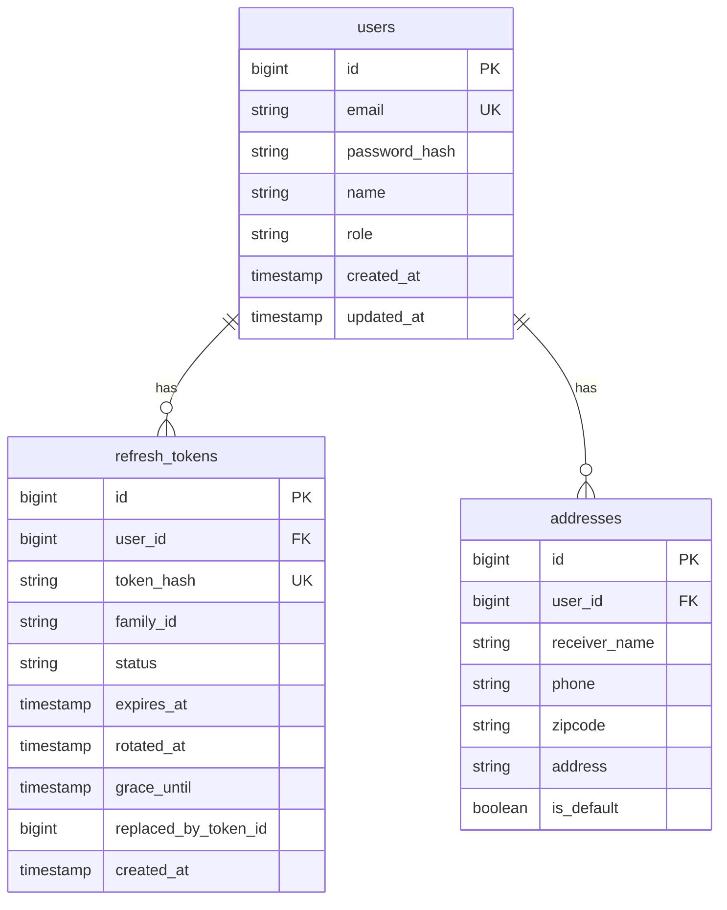
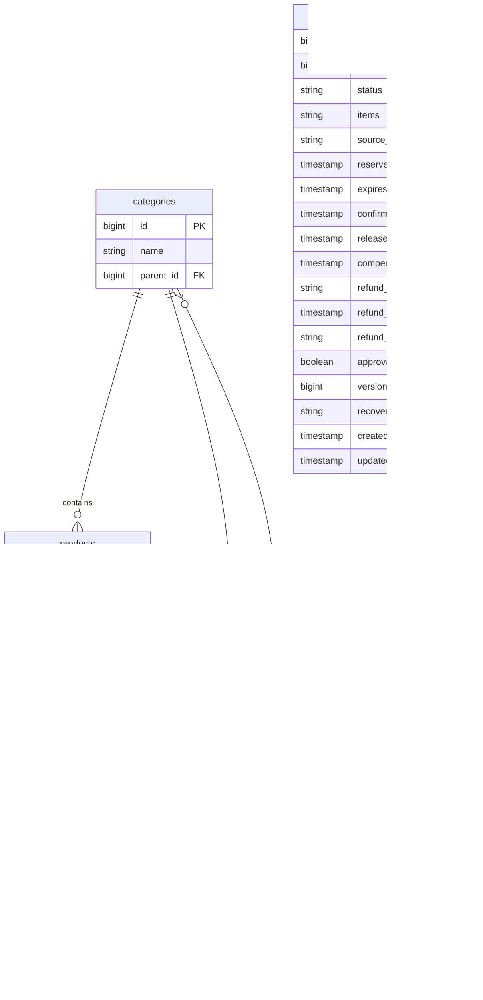
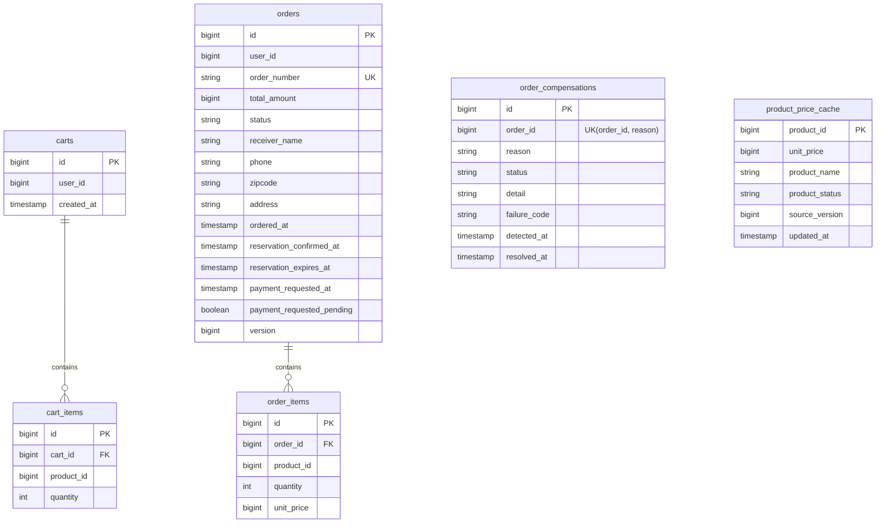
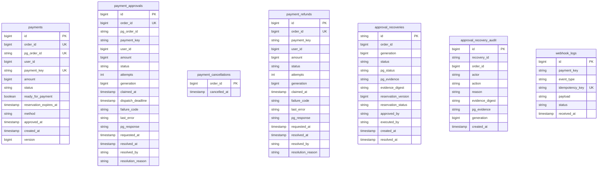
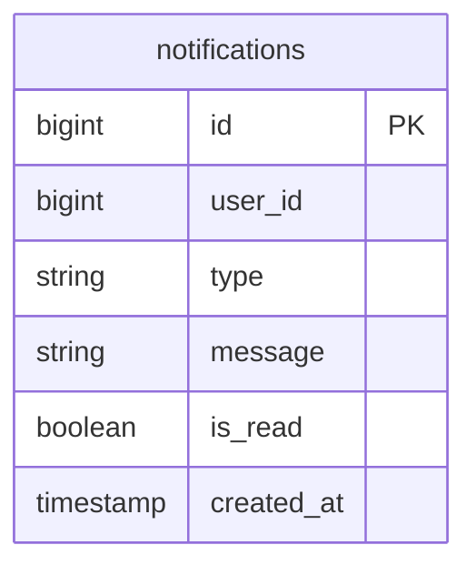

## 11. ERD 설계

> Phase 1 단일 DB ERD, Phase 2 변경점, Phase 1 대비 비교표는 [설계 아카이브](progress/archive/design-archive-phase1-2.md#05-data-designmd-11-erd-설계)로 옮겼다.

### Phase 4 — 서비스별 DB 분리 (MSA)

> DB 간 FK 제약 없음 — 필요한 데이터는 이벤트 수신 시점에 스냅샷으로 저장합니다.
Kafka 를 쓰는 order·product·payment·notification DB 에는 같은 컬럼의 메시징 테이블이 있습니다(아래 "공통 메시징 테이블"). notification 의 `outbox_events` 는 DLQ replay 재발행 전용입니다 (see ADR-0020).
>
> **물리 구성 (구현 ② PR2, see ADR-0012 §D1·ADR-0016)**: 5개 서비스가 각자 독립 스키마(`peekcart_user`/`peekcart_product`/`peekcart_order`/`peekcart_payment`/`peekcart_notification`) + 독립 계정·권한(자기 스키마에만 GRANT) + 독립 Flyway 이력(`V1__init_<svc>.sql`)을 소유합니다. 현재는 **1 MySQL 인스턴스 + 5 스키마**(논리 분리)이며, 인스턴스 물리 분리는 datasource URL 교체만으로 가역 승격 가능합니다. 교차 도메인 FK 6개는 PR1(V13)에서 제거하고 ID 참조로 대체했습니다.

### 공통 메시징 테이블 (order·product·payment·notification)

네 서비스 DB 는 아래 다섯 테이블을 같은 컬럼으로 각자 가진다. 실행 코드는 `peekcart-common-messaging` 이 공유하고 스키마는 서비스가 소유한다 (see ADR-0033). 컬럼의 정본은 각 서비스의 `src/main/resources/db/migration/` 이고, DLQ 원장의 서비스 간 동일성은 `scripts/dead-letter-schema-parity-lint.sh` 가 검사한다. 서비스별 ERD 에는 이 테이블을 다시 그리지 않는다.

| 테이블 | 역할 | 컬럼 |
| --- | --- | --- |
| `outbox_events` | 발행 대기 이벤트. 업무 이벤트와 replay 재발행을 `record_kind` 로 가른다. `trace_id`·`user_id` 는 trace context 다 (see ADR-0008) | `id`, `aggregate_type`, `aggregate_id`, `event_type`, `event_id`(UK), `payload`, `status`, `retry_count`, `last_attempted_at`, `created_at`, `published_at`, `trace_id`, `user_id`, `record_kind`, `destination_topic`, `destination_partition`, `record_key`, `source_record_timestamp`, `replay_target_event_id`, `replay_headers`, `replay_root_record_id`, `target_consumer_group` |
| `processed_events` | 소비 멱등 이력. 9일 보존 뒤 배치로 지운다 | `id`, `event_id`, `consumer_group`(`event_id` 와 복합 UK), `processed_at` |
| `dead_letter_records` | DLQ 원장. 좌표, 원본 메시지, 처리 상태와 감사, replay 축으로 나뉜다 | `id`, `cluster_id`, `topic_generation`, `origin_topic`, `origin_partition`, `origin_offset`, `failed_consumer_group`, `origin_kind`, `event_id`, `original_key`, `original_timestamp`, `payload`, `payload_truncated`, `exception_type`, `exception_message`, `status`, `attempt_count`, `occurred_at`, `acknowledged_at`, `acknowledged_by`, `discarded_at`, `discarded_by`, `note`, `resolved_at`, `resolved_by`, `reopened_at`, `reopened_reason`, `root_record_id`, `publication_status`, `outbox_event_id`, `last_replay_attempt_id`, `last_replay_target_group`, `replay_deadline`, `replay_policy`, `last_replay_payload_digest`, `last_replay_settled_at`, `last_replay_by`, `publication_override_by`, `publication_override_reason` |
| `dead_letter_record_ids` | DLQ 원장 ID 예약용 AUTO_INCREMENT (아래 절) | `id` |
| `shedlock` | 스케줄러 분산 락 | `name`, `lock_until`, `locked_at`, `locked_by` |

### 공유 DLQ 원장의 ID 예약

order/product/payment/notification DB는 `dead_letter_record_ids`의 AUTO_INCREMENT 값으로 ID를 예약한다. 적재 트랜잭션이 예약 행을 만들고 자신의 행을 삭제하며, 첫 `dead_letter_records` INSERT에 ID와 self 또는 검증된 parent root를 함께 기록한다. 좌표 중복은 attempt를 증가시킨 실제 affected count와 current read의 ID·예약 ID 점유를 함께 대조해 판정한다. 예상 밖 PK 충돌과 같은 ID의 재사용은 rollback한다. ID gap은 허용하며 예약 counter를 TRUNCATE/reset하지 않는다(see ADR-0043).

migration은 기존 ledger 최대 ID 다음부터 예약하도록 준비하며 기존 ID를 바꾸지 않는다. 구 writer를 멈추고 bootstrap 및 모든 writer 전환을 완료해야 하며, 혼합 실행의 안전성은 보장하지 않는다. 운영 접수 중지·배포는 수행하지 않았다.

### replay 판별자 NOT NULL contract

`dead_letter_records.root_record_id`와 `outbox_events.record_kind`는 contract migration(order V15·product V14·payment V16·notification V10, 네 벌 동일)에서 DEFAULT 없는 NOT NULL이 된다. 값을 빠뜨린 INSERT는 strict 모드에서 실패하고, 원장 incident 집계는 `root_record_id = id`만 root로 센다(see ADR-0020 §D3·§D6-3).

같은 디렉터리의 `beforeMigrate__dead_letter_replay_contract_guard.sql`이 매 migrate 시작에 두 컬럼이 아직 nullable이면 NULL·0 이하 root와 정확히 `DOMAIN`·`REPLAY`가 아닌 kind를 센다. 하나라도 있으면 migration 전에 실패하고(오류 1231, 메시지 `D065_CONTRACT_GUARD invalid_root_rows=N invalid_kind_rows=M`) Flyway history에 행을 남기지 않으며 자동 보정하지 않는다. 빈 DB와 contract 이후에는 검사하지 않는다. contract 이후 INSERT IGNORE가 만드는 0·빈 문자열은 막지 않으므로 writer 정지 전제가 남는다. 운영 DB 적용은 수행하지 않았다.

### User DB

> `refresh_tokens` 는 토큰 원문 대신 SHA-256 해시(`token_hash`)를 저장하는 이력 모델이다. `status`(ACTIVE/ROTATED/REVOKED), `grace_until`, `replaced_by_token_id` 로 rotation 과 Reuse Detection 을 판정한다 (see ADR-0013 §D4).

> Redis 는 로그아웃한 access token 의 블랙리스트와 family deny 를 별도로 둔다. 탈취를 감지하면 이미 발급된 access token 도 Gateway 가 바로 차단한다 (see ADR-0013).
>

### Product DB

> Product 는 `product.updated`·`stock.*` 를 발행하고 `order.created`·`payment.*` 를 소비하므로 공통 메시징 테이블을 가진다. `expires_at` 은 예약 lease 만료 시각이고 `approval_fenced`·`version`·`recovery_id` 는 승인 보호와 대사 복구용이다(아래 ADR-0034·ADR-0040 절). 재고 예약은 `inventories` 의 예약 컬럼이 아니라 **별도 `stock_reservations` 테이블**(orderId 단위 예약 원장)로 구현됐다 (see ADR-0012 §D1/§D3, **ADR-0016** — 재기록). `order_id`/`source_event_id` 는 교차 도메인 ID 참조(FK 없음, 구현 ② PR1 V13). **`compensated_at` 은 감지 marker 이지 종결 표시가 아니며**, 환불 종결은 `refund_result`/`refund_resolved_at`/`refund_failure_code`(V4, 구현 ④-c-1b)에 별도로 남습니다 (see ADR-0018 §D4).

### Order DB

> `order_items`의 `product_name`, `unit_price`는 주문 시점 스냅샷으로 저장 (상품 가격 변경 대응)
`cart_items`는 최신 상품 정보를 반영해야 하므로 스냅샷 컬럼을 포함하지 않습니다. 담기 시점의 상품 존재 검증은 Order 로컬 캐시(`product_price_cache`)로 하며, Product 동기 호출은 없습니다(strangler-4). 장바구니 조회·추가·수정 응답은 로컬 캐시의 이름·단가·상태를 한 번에 조회해 조합합니다. `productName`/`unitPrice`/`productStatus`/`available`은 미수신 시 null이며 item은 유지합니다. `available`은 이벤트 시점의 상품 상태이며 실시간 재고 보장이 아닙니다. 기존 가격 전용 행의 이름·상태는 다음 더 높은 version 수신까지 null입니다 (see ADR-0036).
>

> Order DB 는 strangler 컬럼(V6 `reservation_confirmed_at`·V9 `payment_requested_at`·V11 `payment_requested_pending`)과 로컬 가격 캐시 `product_price_cache`(CQRS ⑤, strangler-2 — product.updated 구독으로 채워짐)를 소유합니다. `user_id`/`product_id` 는 교차 도메인 ID 참조(FK 없음, 구현 ② PR1 V13). `orders.version` 은 낙관적 락, `reservation_expires_at` 은 Product 가 `stock.reservation.result` 로 준 예약 lease 만료 시각이다(V3). `order_compensations`(V4, 구현 ④-a)는 "보상이 필요하다"를 영속 사실로 남기는 원장이며, 종결은 `payment.refunded` 회신이 `RESOLVED`(환불 완료) 또는 `REFUND_FAILED`(+`failure_code`, 닫혔지만 미해결)로 수행합니다 (V5, 구현 ④-c-1b, see ADR-0018 §D4).

### Payment DB

> **`payment_failures` 미구현 → `payment_cancellations`**: ADR-0012 D1 은 Payment 에 `payment_failures` 를 두었으나 구현은 `payments.status='FAILED'` 로 실패를 표현하고, 대신 `payment_cancellations`(order.cancelled 선도착 silent-charge 방지 marker, strangler)를 둔다 (see ADR-0012 §D1, **ADR-0016** — 재기록). **`payment_refunds`**(V4, 구현 ④-c-1a)는 환불 진행 상태를 소유하는 별도 원장으로, `order_id` UNIQUE 가 "동일 논리 환불 1건" fence 이고 `generation` 이 fencing token 입니다. `payments.status` 에는 종결 상태 `REFUNDED` 만 추가됩니다 (see ADR-0018 §D2/§D3). `order_id`/`user_id` 는 교차 도메인 ID 참조(FK 없음, 구현 ② PR1 V13). 승인 원장 `payment_approvals`(조회 기반 reconciliation, see ADR-0023)와 대사 복구 원장 `approval_recoveries`·`approval_recovery_audit` 은 아래 ADR-0034·ADR-0040·ADR-0042 절이 설명한다.

### Notification DB

> Notification Service 가 DB 를 소유함을 ADR-0010 §D1 (F1) 에서 확정 — `02-architecture.md §5` DataLayer 와 정합 (see ADR-0010).

> 소비 멱등 이력과 DLQ 원장, replay 재발행용 `outbox_events` 는 "공통 메시징 테이블" 절에 있다.

### 인덱스 전략

| 테이블 | 인덱스 | 용도 |
| --- | --- | --- |
| `orders` | `idx_orders_user_id_status (user_id, status)` | 사용자별 주문 내역 조회 (상태 필터) |
| `orders` | `idx_orders_status_ordered_at (status, ordered_at)` | 타임아웃 스케줄러 조회 (PAYMENT_REQUESTED + 시간 조건) |
| `orders` | `idx_orders_user_id_ordered_at (user_id, ordered_at)` | 주문 내역 커서 페이지네이션 (`ordered_at DESC, id DESC`). `id` 미명시 — InnoDB 세컨더리 인덱스가 PK 를 암묵 부착해 tie-break 까지 이 인덱스로 처리된다 (구현 ⑥) |
| `orders` | `idx_orders_reservation_expiry (status, reservation_expires_at)` | 예약 lease 가 만료된 PENDING 주문 취소 잡 조회 |
| `order_items` | `idx_order_items_order_id (order_id)` | 주문별 상품 목록 조회 |
| `products` | `idx_products_category_status (category_id, status)` | 카테고리별 상품 목록 조회 |
| `stock_reservations` | `idx_stock_reservations_lease (status, expires_at)` | lease sweeper 의 만료 `RESERVED` 조회 |
| `outbox_events` | `idx_outbox_status_created (status, created_at)` | Polling 스케줄러 대상 조회 (PENDING 상태) |
| `outbox_events` | `trace_id` / `user_id` 컬럼은 인덱스 없음 | trace 기반 조회는 사후 ad-hoc 분석용 — 인덱스 추가 시 insert/update 비용만 증가 (see ADR-0008) |
| `processed_events` | `uk_processed_event_consumer (event_id, consumer_group)` | 멱등성 체크 (중복 소비 방지, 복합 UK) |
| `processed_events` | `idx_processed_events_processed_at (processed_at)` | 보존 기간이 지난 이력의 배치 삭제 |
| `notifications` | `idx_notifications_user_id (user_id)` | 사용자별 알림 목록 조회 |
| `refresh_tokens` | `idx_refresh_tokens_user_id (user_id)` | 사용자별 토큰 조회/삭제 |
| `refresh_tokens` | `uk_refresh_tokens_token_hash (token_hash)` | 제시된 토큰의 해시 조회 (UK) |
| `refresh_tokens` | `idx_refresh_tokens_family_id (family_id)` | reuse 감지 시 family 단위 무효화 |

### 승인 예약 보호 확장 (see ADR-0034)

- Product V11: `stock_reservations.approval_fenced BOOLEAN NOT NULL DEFAULT FALSE`. 상태에 `APPROVAL_HELD`를 추가한다. 이 영속 flag는 성공 환불 시 HELD/CONFIRMED 재고를 복구할 권한을 legacy 예약과 구분한다. 해제 CAS와 재고 증가/환불 marker는 같은 트랜잭션이다.
- Payment V12: `payment_approvals.dispatch_deadline DATETIME(6) NULL`. 새 접수는 항상 기한을 기록하고 `WAITING_STOCK → READY → CLAIMED`를 거친다. 기존 CLAIMED/UNRESOLVED는 NULL이어도 조회 기반 확정을 계속한다. 신규 상태는 기존 VARCHAR 상태 컬럼을 사용한다.
- `order_id` UNIQUE는 그대로 주문당 승인 1건을 보장한다. 새 dispatcher와 회신/timeout 처리는 원장 행 잠금을 공유한다. CLAIMED의 generation은 조회 claim마다 증가하며 과거 실행자의 확정을 거부한다.

승인 보호 후속 보강은 추가 마이그레이션 없이 `dispatch_deadline`을 신규 fence 접수 표지로 재사용한다. 신규 미결의 수동 감사는 `resolved_by`·`resolution_reason`만 기록하고 `resolved_at=NULL` 및 `UNRESOLVED`를 유지한다(see ADR-0035).

### 장바구니 상품 metadata 확장 (see ADR-0036)

Order V13은 `product_price_cache.product_name VARCHAR(255) NULL`, `product_status VARCHAR(32) NULL`을 추가합니다. 가격과 metadata는 같은 `source_version` 비교로 원자 갱신하고 version은 마지막에 대입합니다. 동일/과거 version은 updated_at을 포함해 변경하지 않습니다. 기존 seed 행은 가격만 보존합니다. 앱 롤백 시 additive 컬럼은 유지합니다.

### 승인 대사 복구 원장 (see ADR-0040, 서버 직접 확정 조회 범위 Accepted)

- Payment V13 `approval_recoveries`: UUID id, order_id, approval generation, 복구 상태, PG 상태/원문(LONGTEXT)/SHA-256, reservation version/status, 승인자·실행자·시각을 보존한다. `(order_id, status)` 인덱스와 approval row lock으로 주문의 활성 복구를 직렬화한다.
- Payment V13 `approval_recovery_audit`: append-only 감사 행에 recoveryId/orderId/actor/action/reason/증거 원문·해시/generation/시각을 기록한다. 유효 운영자의 거절은 별도 트랜잭션이며 증거가 없으면 빈 원문과 그 해시, generation=-1로 구분한다. 해시 자체를 PG 진위 증명으로 사용하지 않는다.
- Product V12 `stock_reservations.version BIGINT NOT NULL DEFAULT 0`, nullable `recovery_id VARCHAR(36)`: entity 변경은 @Version, 여섯 bulk CAS는 version 증가로 같은 snapshot 경계를 지킨다. 복구는 snapshot version/APPROVAL_HELD/fence 조건과 row lock 안에서 재고를 한 번만 복원한다. 같은 recoveryId 재전달은 재고를 다시 더하지 않는다.
- `payment_approvals.RECOVERY_PENDING`: 자동 reconciliation claim 대상에서 제외하는 운영 실행 대기 상태다. 신규 generation으로 기존 실행자를 fence하고 Product 확인 뒤 FAILED를 확정한다. 명시적인 Product 거절의 재개도 이 상태를 유지하며 새 generation/snapshot/승인을 요구한다. 장기 미결 gauge 및 경보에는 포함한다.

상태 변경·감사·업무 outbox는 같은 트랜잭션에 기록한다. 네 신규 메시지의 소비는 inbox와 같은 트랜잭션이며 일반 replay 정책은 DENY다. Product snapshot의 확인 없이 교차 DB 조회나 동기 Product HTTP로 상태를 결정하지 않는다. 업무 DDL 배포 후 소비자/replay 정책을 배포하고 마지막으로 운영 역할을 설정한다.

### PG 주문 식별자 (see ADR-0042)

Payment V14는 `payments.pg_order_id VARCHAR(64) NULL`과 UNIQUE `uk_payments_pg_order_id`, `payment_approvals.pg_order_id VARCHAR(64) NULL`을 추가한다. 신규 Payment 생성 시 `pc_`와 UUID hex 32자를 저장하며 수정하지 않는다. 승인 접수 native INSERT가 같은 값을 snapshot으로 기록하여 이후 PG 승인·조회·복구가 같은 ID를 사용한다. 기존 NULL은 기존 숫자 order_id 문자열 계약이고 backfill하지 않는다. UNIQUE는 신규 canonical ID의 충돌만 막으며 기존 NULL 행을 허용한다. 내부 order_id의 이벤트·멱등키·원장 UNIQUE 의미는 유지한다.
